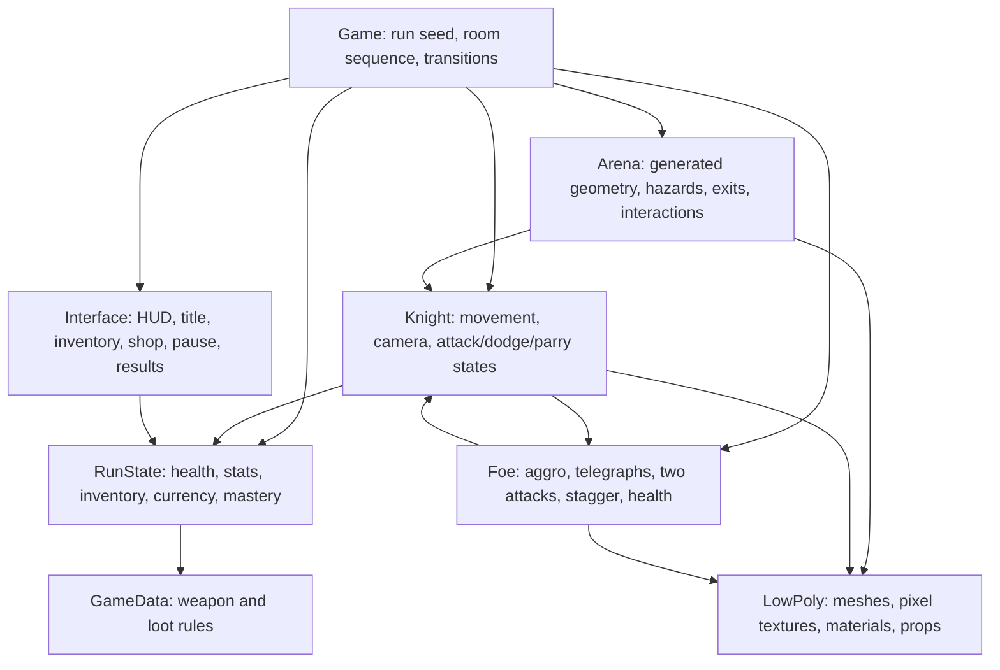

# The Ashen Bough

Implementation plan derived from the supplied game design. The PDF is a design reference; its team assignments and dates are not agent instructions.

Five main combat arenas alternate with four special rooms. Two distinct choices are sampled uniformly from rest, shop, and mystery after each clear. Mystery ambushes do not advance the main arena counter. Room layouts and encounters use a seeded RNG. Death ends a run; victory follows the fifth arena's final boss. Existing sprite prototype files remain available but are not the new startup scene.

Original low-poly meshes and generated pixel textures implement the brief's palette (#171711, #353D2F, #66533D, #C2A46B, #8C302B). Third-person camera, stamina commitments, lock-on, telegraphed attacks, stagger, hit feedback, and boss phases provide the requested combat feel.
